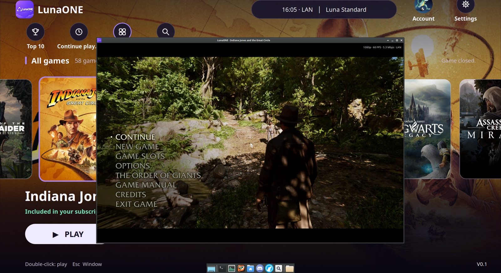
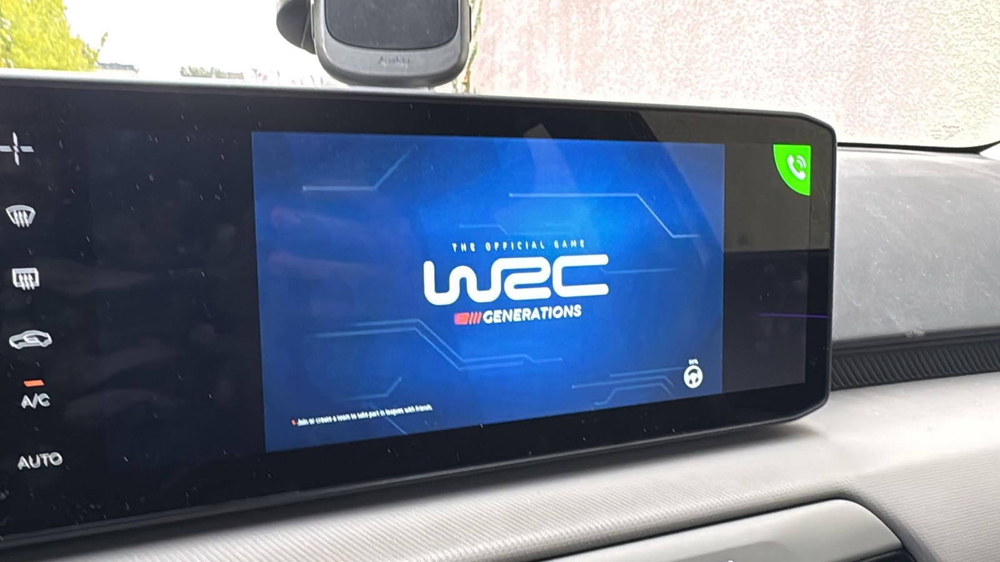
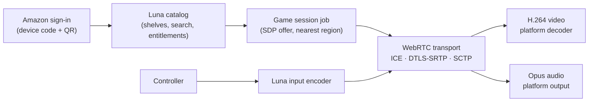

<p align="center">
  
</p>

<h1 align="center">LunaONE</h1>

<p align="center">
  <strong>The open-source Amazon Luna cloud gaming client: play Luna without a web browser.</strong><br>
  macOS · Windows · Linux · FreeBSD · iPhone &amp; iPad · Android · Google TV
</p>

<p align="center">
  <a href="LICENSE"></a>
  
  
</p>

> [!IMPORTANT]
> **LunaONE is an independent community project. It is not affiliated with, endorsed by or sponsored by Amazon or Amazon Luna.** Amazon and Amazon Luna are trademarks of their respective owners. LunaONE does not provide games, accounts or subscriptions: you sign in with your own Amazon account and play the games your Luna plan gives you access to.

## Download

Get **[LunaONE V0.2](https://github.com/kazar-root/LunaONE/releases/latest)** for macOS, Windows, Linux, FreeBSD, Android and Google TV, and iPhone and iPad. The release page explains how to install each version.

Website: **[kazar-root.github.io/LunaONE](https://kazar-root.github.io/LunaONE/)**

## What is LunaONE?

LunaONE lets you play your Amazon Luna games in a native app instead of a web browser. It is built for the couch: pick up a controller, browse the catalog, press A and play. The same app runs on your Mac, your PC, your Linux or FreeBSD machine, your iPad, your Android phone and your Google TV.

LunaONE is a fork of my project **[LunaNX](https://github.com/kazar-root/LunaNX)**, the Amazon Luna client for the Nintendo Switch. LunaONE takes the LunaNX engine (Amazon sign-in, Luna catalog, game sessions, streaming and controller input), ports it to modern C++20 and brings it to every major platform with one shared code base.

I hope LunaONE will please as many players as possible. Feedback, bug reports and contributions are very welcome!

*— KazaR-RooT*

## Screenshots

<p align="center">
  
  
</p>
<p align="center"><sub>Left: FreeBSD, Indiana Jones and the Great Circle in 1080p at 60 FPS over a wired network. Right: Android Auto in a car, WRC Generations.</sub></p>

## Features

- **Sign in without typing a password.** Scan the QR code, confirm the code on Amazon's official page, and you're in.
- **The whole Luna catalog.** Top 10, Recently Played, All Games and search, with large cover art. Games that are not in your plan are clearly marked.
- **Smooth streaming up to 1080p at 60 FPS**, with a quality profile for every connection:

  | Profile | H.264 profile offered | Picture | Best for |
  | --- | --- | --- | --- |
  | **Automatic** (default) | Platform default | Follows your screen; Luna adapts the stream to what it measures | Everyone |
  | Low | Baseline | 720p, 30 FPS, steady bitrate | Weak Wi-Fi |
  | Medium | Main | 720p, 60 FPS | Average Wi-Fi |
  | High | High | 1080p, 60 FPS, Luna's best quality | Good Wi-Fi |
  | Ultra | High | 1080p, 60 FPS, high minimum bitrate, full-rate audio | Wired connection |
  | Custom | — | Resolution, frame rate, bitrate and mode set by hand | Tinkerers |

- **Made for controllers.** Xbox, PlayStation, Nintendo and 8BitDo controllers, wired over USB or wireless over Bluetooth, with the button names of the controller in your hands. Swap A/B, swap X/Y and invert the left stick, in the menus and in game.
- **Handy shortcuts.** L3 + R3 + R1 leaves a game. L1 + L2 + R1 + R2 opens the on-screen keyboard for search. L3 + R3 shows the technical overlay.
- **Keyboard, mouse and TV remote** work in the library, before the game starts: browse the catalog, open the settings, or search for a game with the keyboard or the on-screen keyboard. In a game session, LunaONE currently sends only the controller to Luna. Keyboard and mouse support in game is in progress.
- **Borderless full screen** on desktop (F11, Alt + Enter on Windows, Control + Command + F on Mac, or the title bar's maximize button, like the Mac's green button; Esc returns to the window).
- **11 interface languages**: English, French, German, Spanish, Italian, Portuguese, Russian, Chinese, Polish, Dutch and Swedish.
- **Private by design.** No LunaONE server and no telemetry (see [Privacy](#privacy)).

## Supported platforms

| Platform | Interface | Video | Audio | Controllers |
| --- | --- | --- | --- | --- |
| macOS 13+ (Apple Silicon and Intel) | AppKit | VideoToolbox, Metal | Audio Queue | GameController |
| Windows 10/11 (x64 and ARM64) | Direct2D, DirectWrite | Media Foundation | waveOut | SDL2 |
| Linux | GTK 3, Cairo, Pango | FFmpeg | SDL2 | SDL2 |
| FreeBSD 14.4+ and 15 (amd64 and ARM64) | GTK 3, Cairo, Pango | FFmpeg | SDL2 | SDL2 |
| iPhone and iPad (iOS / iPadOS 17+) | UIKit | VideoToolbox | Audio Queue | GameController |
| Android 8+ and Google TV | Android views | MediaCodec | AAudio | Android gamepads |
| Apple Watch (watchOS 10+) | SwiftUI | Mirrored from the iPhone | — | A, B, Digital Crown |

macOS is the reference client. The other platforms share the same engine and are in active testing. On Apple Watch, the game runs on the paired iPhone and its picture is mirrored on the wrist ([how it works](docs/IPADOS.md#apple-watch-mirror)).

## FAQ

### Can I play Amazon Luna on Linux or FreeBSD?

Yes. LunaONE is a native GTK app for Linux and FreeBSD, with FFmpeg for video and SDL2 for sound and controllers. The release has archives for Alpine Linux ARM64 and for FreeBSD 14.4, 14.5, 15.0 and 15.1 on amd64 and ARM64. Other Linux distributions can [build it from source](#building).

### Can I use a PS5 DualSense, a PS4 DualShock 4, a Switch Pro Controller or an 8BitDo controller with Amazon Luna on Windows?

Yes, over USB or Bluetooth, with no extra software. 8BitDo controllers work in X-input, Switch and D-input modes. LunaONE names the buttons as they are printed on the controller in your hands.

### Does Amazon Luna work on Android TV, Google TV or in a car?

The LunaONE APK runs on Android 8+ phones and tablets, on Google TV with the TV remote, and on the Android screen of a car (see the [screenshots](#screenshots)).

### How do I play Amazon Luna on iPhone or iPad without Safari?

Install the LunaONE IPA with [AltStore](https://altstore.io) or [Sideloadly](https://sideloadly.io) and your own Apple ID. An Apple Watch can mirror the game when you build the app from source.

### Can I use a keyboard and mouse?

In the library, yes: browse, open the settings or search for a game, also with the on-screen keyboard. In a game, LunaONE currently sends only the controller to Luna. Keyboard and mouse support in game is in progress.

### Is LunaONE official? Do I need a Luna subscription?

LunaONE is an independent open-source project, not affiliated with Amazon. You sign in with your own Amazon account and play the games your Luna plan includes.

## How it works



1. **Sign-in.** LunaONE registers itself as an Amazon device with Amazon's device-code flow. You confirm a short code on Amazon's own website; LunaONE never sees your password. The resulting tokens are stored only in the app's private data folder on your device.
2. **Catalog.** The app reads the same Luna pages as the official clients, follows their linked collections to build the complete catalog, and checks which games your plan includes.
3. **Session.** When you press Play, LunaONE measures the Luna regions, picks the nearest one and asks Luna for a game session with a WebRTC offer that describes what it can decode. It shows the launch progress while the cloud machine starts. You can cancel the launch at any time.
4. **Streaming.** The video and audio arrive over WebRTC: ICE connectivity, DTLS-SRTP encryption ([libpeer](https://github.com/sepfy/libpeer), [Mbed TLS](https://github.com/Mbed-TLS/mbedtls), [libSRTP](https://github.com/cisco/libsrtp)), retransmission of lost packets and a jitter buffer. H.264 pictures go to the platform's hardware decoder, and Opus audio goes to the platform's low-latency output.
5. **Input.** The controller is read every 2 ms and encoded in Luna's input format (Xbox layout), then sent over the WebRTC data channel. Your button options (swap A/B, swap X/Y, invert Y) are applied before sending. The keyboard and mouse are not sent to the game yet.
6. **Quality.** The app tells Luna the resolution, frame rate and bitrate range it wants. Luna's servers adapt the stream within that range to your connection.

### Source layout

| Path | Contents |
| --- | --- |
| `app/src/luna` | Amazon sign-in, Luna API client, catalog, SDP |
| `app/src/webrtc` | Game session and streaming engine |
| `app/src/stream` | Audio buffering and video quality helpers |
| `app/src/input` | Controller encoding and button names |
| `app/src/core` | Settings, quality profiles, translations, storage, logs |
| `app/src/ui` | Library interface shared by Windows, Linux and FreeBSD, on-screen keyboard |
| `app/apple`, `app/ipados` | macOS and iPhone/iPad apps |
| `app/windows`, `app/linux` | Windows app, and the GTK app for Linux and FreeBSD |
| `app/android` | Android and Google TV app |
| `app/cli` | Command-line client |
| `third_party` | libpeer, Mbed TLS, libSRTP, Opus, Jansson, QR Code generator |
| `tests` | Unit and integration tests (CTest) |

## Building

All platforms use CMake 3.25 or newer and a C++20 compiler.

**macOS** (full Xcode installed):

```sh
cmake --preset macos
cmake --build --preset macos
ctest --preset macos
open build/macos/Debug/LunaONE.app
```

**Linux** (Ninja and the development packages for libcurl, GTK 3, SDL2 and FFmpeg):

```sh
cmake --preset linux
cmake --build --preset linux
ctest --preset linux
./build/linux/LunaONE
```

**FreeBSD** (packages installed as root with `pkg install cmake ninja pkgconf curl gtk3 ffmpeg sdl2 dejavu`):

```sh
cmake --preset freebsd
cmake --build --preset freebsd
ctest --preset freebsd
./build/freebsd/LunaONE
```

**Windows** (x64 or ARM64 toolchain, Ninja, libcurl):

```powershell
cmake --preset windows
cmake --build --preset windows
ctest --preset windows
.\build\windows\LunaONE.exe
```

**Android and Google TV** (JDK 17, Android SDK 35, NDK 28.2.13676358):

```sh
app/android/build-apk.sh
```

**iPhone and iPad** (Xcode, your own Apple Development team):

```sh
cmake --preset ipados -DLUNACORE_APPLE_TEAM_ID=YOUR_TEAM_ID
open build/ipados/LunaONE.xcodeproj
```

More details: [Windows, Linux and FreeBSD](docs/DESKTOP.md) · [Android and Google TV](docs/ANDROID.md) · [iPhone and iPad](docs/IPADOS.md) · [macOS streaming](docs/MACOS-STREAMING.md) · [LunaNX source audit](docs/LUNANX-AUDIT.md)

## Privacy

- Your Amazon sign-in, cookies, settings, recently played games and logs stay in the app's private data folder on your device. Use **Sign out** in the settings to remove them.
- LunaONE has no server of its own and sends no telemetry. It only talks to Amazon and Luna, to Luna's streaming servers, and to the GitHub API when you check for updates.
- The diagnostic log (`runtime.log`) never leaves your device. Please remove personal details before you attach it to an issue.

## Roadmap

LunaONE keeps growing. I am currently developing versions for:

- **Anbernic** handhelds
- **PlayStation**: PS Vita, PS4 and PS5
- **Nintendo DS**

Stay tuned!

## Contributing

Bug reports, ideas and pull requests are welcome. Please open an issue describing your device, your platform and what happened. Run the tests (`ctest`) before you send a pull request.

## Credits and license

**LunaONE is created by KazaR-RooT** and released under the [GNU General Public License v3.0](LICENSE). It is a fork of **[LunaNX](https://github.com/kazar-root/LunaNX)**, also by KazaR-RooT. Preserve the original notices when sharing the project. Dependencies retain their own authors and licenses; see [NOTICE](NOTICE), [THIRD_PARTY_NOTICES.md](THIRD_PARTY_NOTICES.md) and [licenses/](licenses).

Thanks to devkitPro, libnx, deko3d, Borealis, libpeer, FFmpeg and averne's NVTEGRA branch, Moonlight-Switch, OpenNOW-Switch, Mbed TLS, libsrtp, usrsctp, curl, Jansson and the other open-source projects listed in the notices, which made LunaNX and then LunaONE possible. LunaONE also builds on Opus, the QR Code generator library by Project Nayuki, SDL2, GTK, Cairo and Pango. Game artwork and game screenshots belong to their respective rights holders.

Development assistance: Claude Code and Codex.

---

<p align="center"><sub>LunaONE is not affiliated with, endorsed by or sponsored by Amazon or Amazon Luna.</sub></p>
